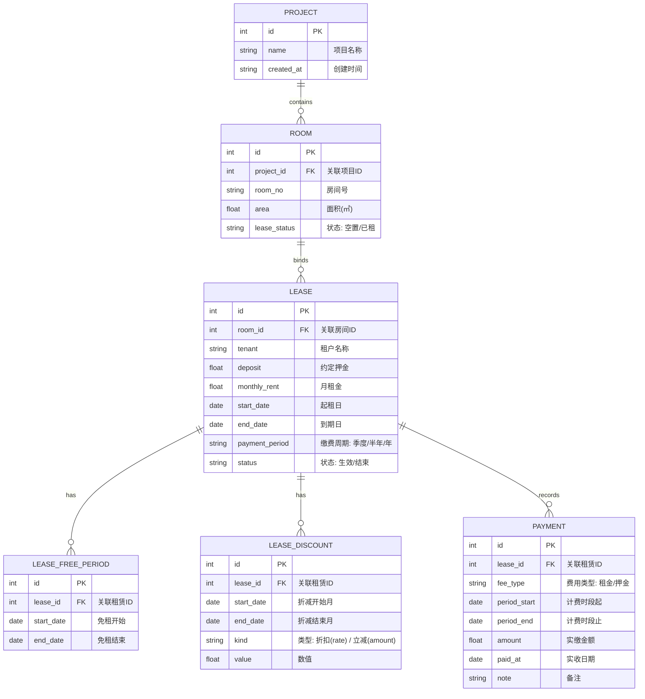
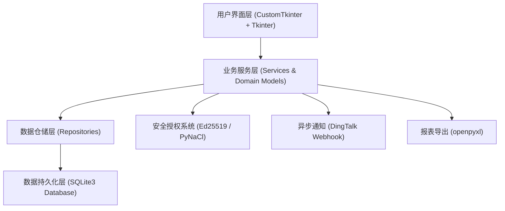

# Tally（本地记账）

> 一款基于 Python + CustomTkinter + SQLite 构建的纯离线、单机轻量级物业与租赁收费管理桌面系统。

[](https://www.python.org/)
[](https://customtkinter.tomschimansky.com/)
[](https://www.sqlite.org/)
[-red.svg)](https://pynacl.readthedocs.io/)
[](https://github.com/yangquan-dev/tally/releases)

---

## 1. 为什么做这个项目（0-1 背景与痛点）

在中小微园区、写字楼商铺及住宅物业租赁管理场景中，管理者通常面临两难境地：
- **传统 SaaS 系统成本过高**：动辄数千上万年费，功能冗余复杂，且要求全程联网，存在敏感租务与财务数据上云的隐私泄露风险；
- **Excel 记账极易出错**：无法自动化按季度/半年切分账单应收期，无法精准分摊多段免租期与阶梯折扣，缺乏到期与逾期催缴的动态看板提醒。

**Tally 的核心目标**：从零构建一个**完全本地存储、开箱即用、界面现代化、账目计算严谨**的离线桌面管理工具。数据完全沉淀在本机 SQLite 数据库中，通过 Ed25519 非对称加密离线授权控制软件许可，并支持通过钉钉 WebHook 机器人将待办提醒推送到工作群。

---

## 2. 核心领域模型与业务设计

系统围绕物业租赁的完整生命周期展开建模，核心实体关系如下：



### 关键业务规则与计算体系

1. **应收期切片与非整月折算**：
   - 按起租日对齐自然缴费周期（季付 = 3个月，半年付 = 6个月，年付 = 12个月）；
   - 末月若未满整月，系统根据当月实际总天数进行天数比例精准折算：
     $$\text{应缴金额} = \text{月租金} \times \frac{\text{计费天数}}{\text{当月完整天数}}$$
2. **免租期与阶段性折减组合分摊**：
   - 支持同一合同配置多段互不重叠的免租期；
   - 支持按租赁月配置立减（如减免 500 元）或折扣（如 85 折）；
   - 系统优先扣除全免时段，其余时段按折后比例精准分摊免租扣减与应收余额。
3. **FIFO 缴费分摊模型**：
   - 一笔连续多期的租金缴纳（如跨两个季度一次性付清），系统按 FIFO（先进先出）逻辑逐期冲抵未缴账单；
   - 限制每次缴纳必须对应**时间轴上严格连续未缴**的应收期，防止跨越已结清期产生账目空洞。
4. **四维提醒看板**：
   - 汇总四类预警：`应收逾期`（🔴）、`即将应收`（🟢）、`合同即将到期`（🔵）、`押金未缴`（🟡）；
   - 支持自定义提前预警天数（默认 7 天）。

---

## 3. 技术架构设计

项目采用分层清晰的单体桌面软件架构（Layered Architecture）：



### 模块结构说明

| 层次/模块 | 文件路径 | 核心职能 |
| :--- | :--- | :--- |
| **引导入口** | [`main.py`](file:///Users/yang/Documents/myself/project/tally/main.py) | 应用主启动入口 |
| **启动环境** | [`app/bootstrap.py`](file:///Users/yang/Documents/myself/project/tally/app/bootstrap.py) / [`config.py`](file:///Users/yang/Documents/myself/project/tally/app/config.py) | 数据目录定位、单例锁检测、PyInstaller 打包环境与开发环境路径适配 |
| **持久化层** | [`app/database.py`](file:///Users/yang/Documents/myself/project/tally/app/database.py) | SQLite 连接池、自动版本 Schema 迁移演进、数据备份（`.bak`）与恢复 |
| **数据仓储** | [`app/repositories.py`](file:///Users/yang/Documents/myself/project/tally/app/repositories.py) | 提供强事务保证的 CRUD 操作（合同、免租期、折减在同一事务提交） |
| **领域服务** | [`app/services.py`](file:///Users/yang/Documents/myself/project/tally/app/services.py) | 租期计算、分摊算法、业务校验、看板统计、数据导入导出 |
| **安全授权** | [`app/license.py`](file:///Users/yang/Documents/myself/project/tally/app/license.py) | Ed25519 非对称密钥验签、许可有效期计算、7 天宽限期控制 |
| **外部通知** | [`app/dingtalk.py`](file:///Users/yang/Documents/myself/project/tally/app/dingtalk.py) | 钉钉群机器人 HMAC-SHA256 签名推送，后台线程异步执行防 UI 阻塞 |
| **UI 页面** | [`app/ui/pages/`](file:///Users/yang/Documents/myself/project/tally/app/ui/pages) | 包含看板、项目、房间、租赁、收费、配置 6 大核心功能页面 |
| **自定义组件**| [`app/ui/widgets.py`](file:///Users/yang/Documents/myself/project/tally/app/ui/widgets.py) | 跨平台暗色/浅色表格组件、单月/双月日历范围选择器、数字格式化输入框 |

---

## 4. 0-1 快速开始（开发环境部署）

### 4.1 环境准备

- Python 3.10+（推荐 Python 3.11 或 3.13）
- 操作系统：macOS 11.0+ / Windows 10+

### 4.2 安装依赖

建议在虚拟环境中安装依赖：

```bash
# 1. 克隆代码仓库
git clone git@github.com-yangquan-dev:yangquan-dev/tally.git
cd tally

# 2. 创建并激活虚拟环境
python3 -m venv .venv
source .venv/bin/activate    # macOS / Linux
# 或 Windows: .venv\Scripts\activate

# 3. 安装运行时与构建依赖
pip install -r requirements.txt
pip install -r requirements-build.txt
```

### 4.3 运行单元测试

```bash
python -m unittest discover tests
```

### 4.4 启动应用

```bash
python main.py
```

> **注意**：首次启动需要导入 `.lic` 授权文件。可在本地生成开发密钥并签发测试许可（见下节）。

---

## 5. 离线授权体系与运维签发

系统采用 **Ed25519 椭圆曲线数字签名算法** 实现离线授权，私钥仅由软件提供方保留，客户端内嵌公钥验签，具备防篡改特性。

### 5.1 生成密钥对（仅首次初始化使用）

```bash
python scripts/issue_license.py gen-keys
```
此命令将在 `keys/` 目录下生成 `ed25519_private.key` 与 `ed25519_public.key`。若更换公钥，需将生成的公钥 Base64 字符串同步替换到 [`app/license.py`](file:///Users/yang/Documents/myself/project/tally/app/license.py#L30) 中的 `PUBLIC_KEY_B64`。

### 5.2 为客户签发离线授权文件

```bash
# 交互式签发（推荐）
python scripts/issue_license.py
# 或 macOS 执行便捷脚本
./scripts/签发授权.sh

# 命令行一键签发（有效期 365 天）
python scripts/issue_license.py issue --customer "某某物业管理有限公司" --days 365 --out ./tally.lic
```
签发出 `.lic` 文件后，用户只需在应用内的**通用配置 → 导入授权**中上传该文件即可激活使用。

---

## 6. 构建与跨平台打包分发

项目采用 [PyInstaller](https://pyinstaller.org/) 进行桌面端原生打包，并已配置跨平台 `.spec` 规则以解决动态链接库与打包资源路径适配。

### 6.1 本机构建

```bash
# 自动识别当前操作系统打包
python scripts/build.py

# 显式指定平台
python scripts/build.py mac    # macOS 平台产出 dist/Tally.app
python scripts/build.py win    # Windows 平台产出 dist/Tally/ (含 Tally.exe 与 _internal)
```

### 6.2 CI/CD 自动化构建（GitHub Actions）

代码库已配置持续集成流水线 [`.github/workflows/build.yml`](file:///Users/yang/Documents/myself/project/tally/.github/workflows/build.yml)：
1. 每次向远程仓库推送版本 Tag（如 `v1.0.5`）时，自动触发构建；
2. 运行自动化单元测试（测试失败立即中断打包）；
3. 分别在 `macos-15-intel` 与 `windows-latest` 环境下执行编译；
4. 自动创建 GitHub Release 并附带平台独立安装包：
   - `Tally-macOS.zip`（含 `Tally.app` 与使用说明）
   - `Tally-Windows.zip`（含便携式绿色运行包与使用说明）

---

## 7. 关键工程实践与设计决策

- **存储策略**：
  - 打包版固定安全数据存储路径（macOS 存放于 `~/Library/Application Support/Tally/data`，Windows 存放于程序自身 `data\` 目录），避免非技术用户选错系统目录；
  - 数据库操作支持安全热备份（导出与导入自动备份为 `.bak`，支持 WAL 日志落盘）。
- **线程模型**：
  - Tkinter 主线程仅负责 UI 渲染与轻量状态流转；
  - 耗时 I/O 操作（如钉钉 WebHook 消息推送、网络检测）均在独立守护线程（`threading.Thread`）执行，保障界面永不卡顿。
- **安全防范**：
  - 卸载逻辑增加安全路径校验，严格杜绝误删桌面（`Desktop`）或系统根目录；
  - 敏感密钥（私钥 `*.key` 与产物 `*.lic`）通过 `.gitignore` 严格排除，防止代码泄露。

---

## 8. 详细操作手册

如需了解各业务功能界面的具体按钮操作、日常使用规范及常见问题排查，请参阅：
📖 **[《本地记账操作手册》（docs/操作手册.md）](docs/操作手册.md)**
